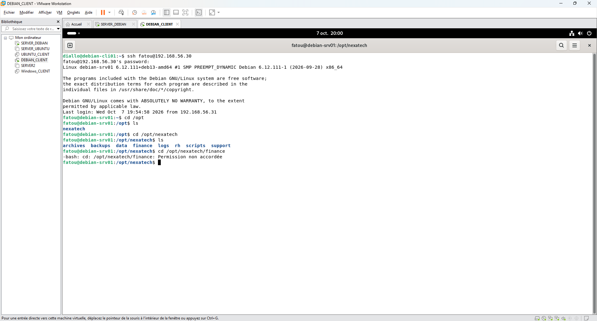
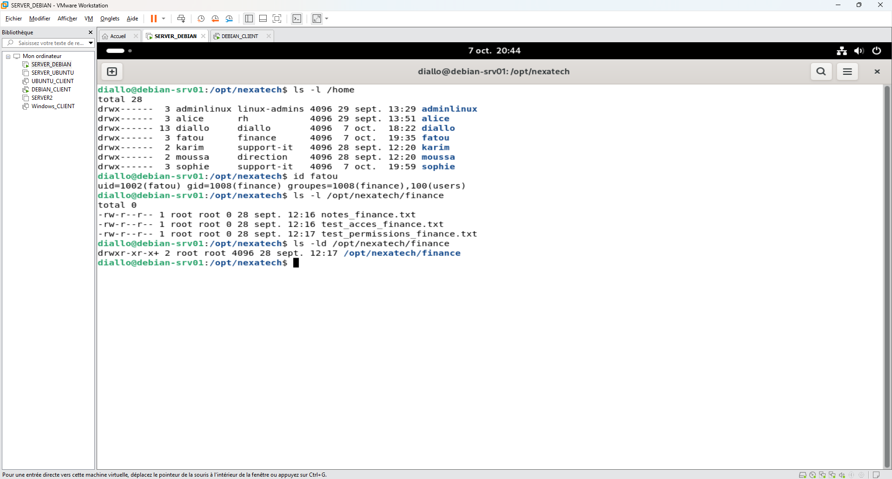
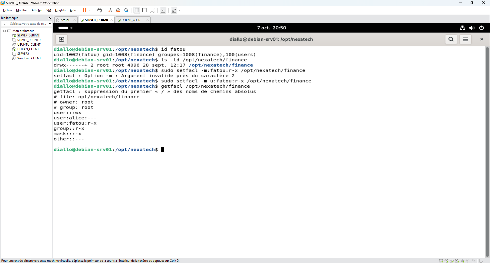
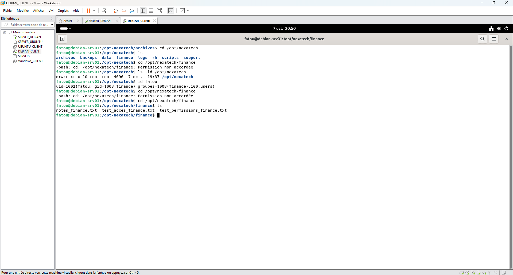

# Incident 01 – Accès refusé au dossier Finance

## 1. Contexte

L'utilisatrice Fatou, membre du service Finance, rencontre un refus d'accès au répertoire `/opt/nexatech/finance` sur le serveur Debian 13.

## 2. Problème rencontré

Connexion SSH réussie depuis `debian-cli01`, mais la commande `cd /opt/nexatech/finance` retourne le message **Permission non accordée**.



## 3. Diagnostic

Vérification de l'appartenance au groupe Finance et des permissions du répertoire :

```bash
id fatou
ls -ld /opt/nexatech/finance
```

Fatou appartient au groupe `finance`. Le dossier est associé à `root:root`, avec des permissions classiques affichées en `755`.



## 4. Résolution

Ajout d'une ACL spécifique permettant à Fatou de lire et de traverser le répertoire.

```bash
sudo setfacl -m u:fatou:r-x /opt/nexatech/finance
getfacl /opt/nexatech/finance
```

La commande `getfacl` confirme la présence de l'entrée `user:fatou:r-x`.



## 5. Vérification finale

Après modification, Fatou parvient à accéder au dossier Finance et à afficher son contenu avec la commande `ls`.



## 6. Prévention

Privilégier la gestion des permissions par groupes et appliquer le principe du moindre privilège pour protéger les données du service Finance.
