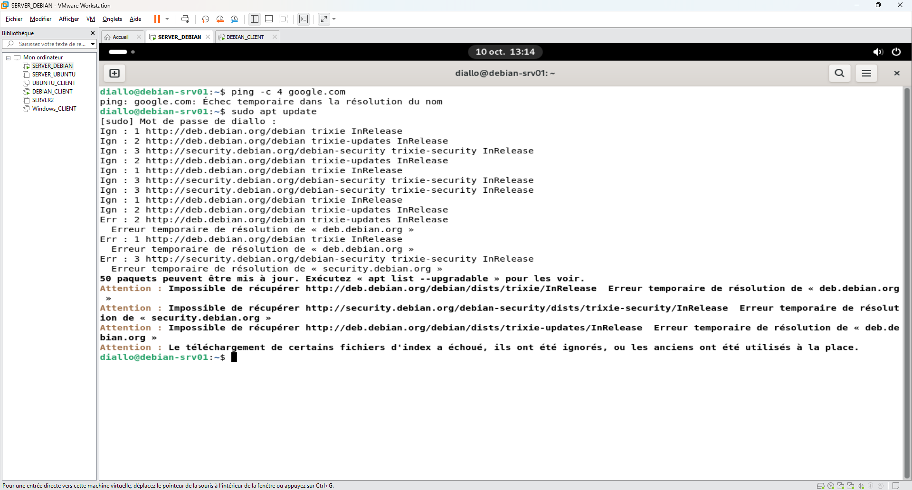
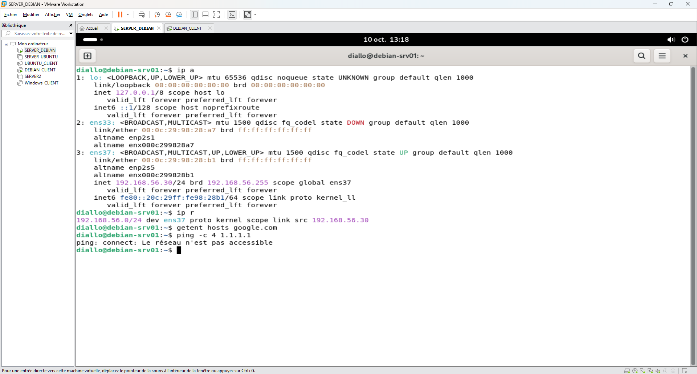
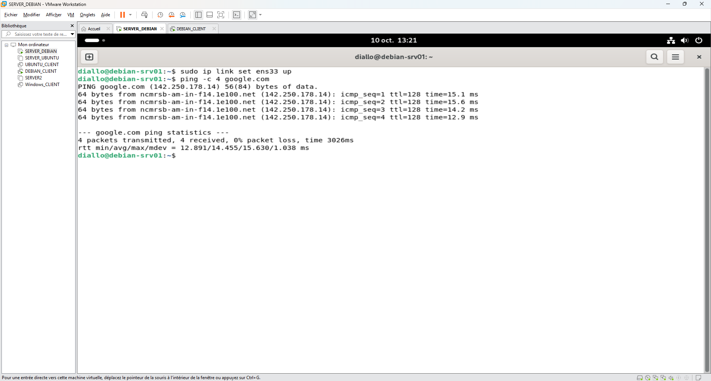
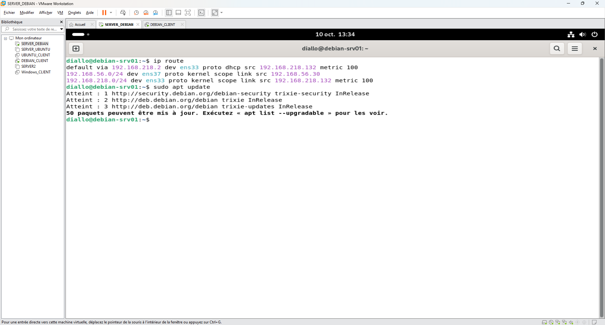

# Incident 02 – Serveur sans accès Internet

## 1. Contexte

Le serveur `debian-srv01` ne parvient plus à accéder à Internet. Les mises à jour Debian échouent.

## 2. Problème rencontré

Les commandes `ping google.com` et `sudo apt update` échouent avec des erreurs de résolution DNS.



## 3. Diagnostic

Vérification des interfaces réseau, des routes et de la connectivité.

```bash
ip a
ip r
ping -c 4 1.1.1.1
```

**Résultats :**
- Interface `ens33` désactivée (`DOWN`).
- Interface `ens37` active (`192.168.56.30`).
- Absence de route par défaut.
- Réseau externe inaccessible.

**Cause identifiée :** l'interface `ens33`, utilisée pour accéder à Internet, était désactivée.



## 4. Résolution

Réactivation de l'interface réseau `ens33`.

```bash
sudo ip link set ens33 up
ping -c 4 google.com
```

**Résultat :** 4 paquets transmis, 4 reçus, 0 % de perte.



## 5. Vérification finale

Contrôle du routage et de l'accès aux dépôts Debian.

```bash
ip route
sudo apt update
```

La route par défaut est rétablie et les dépôts Debian sont de nouveau accessibles.



## 6. Prévention

- Vérifier l'état des interfaces réseau.
- Contrôler la route par défaut.
- Vérifier la configuration réseau permanente pour éviter une nouvelle interruption après redémarrage.
