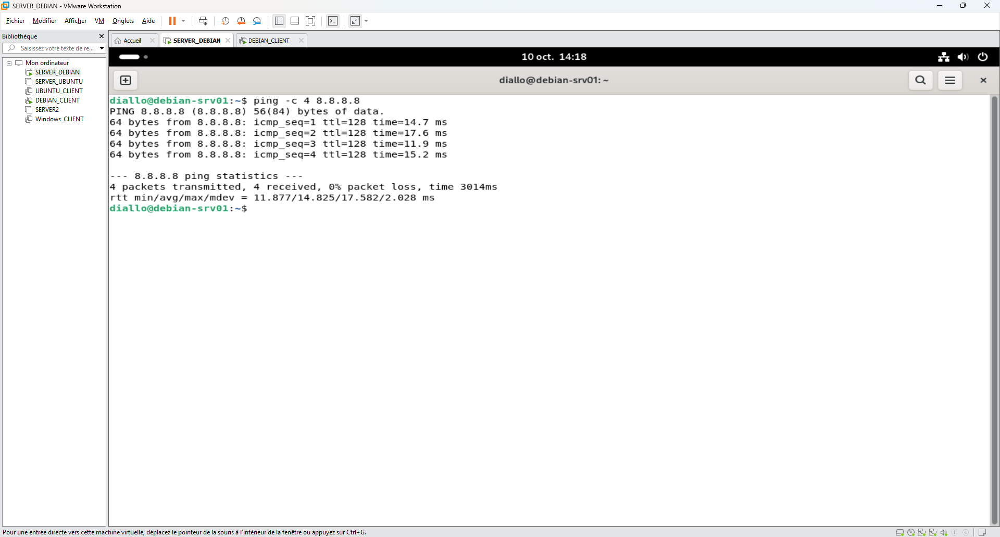
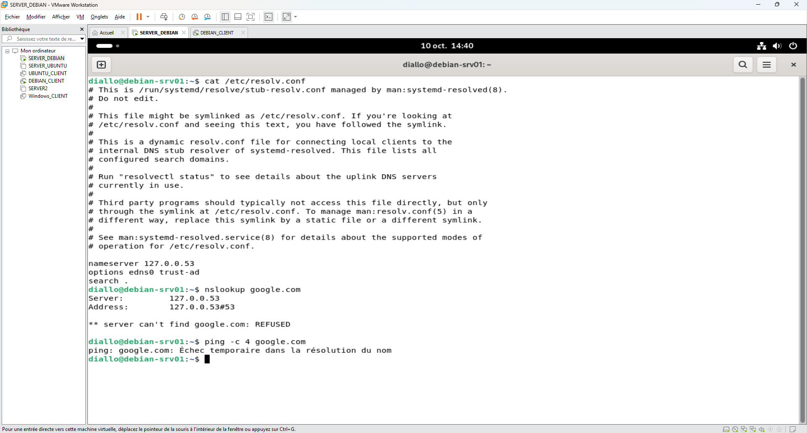
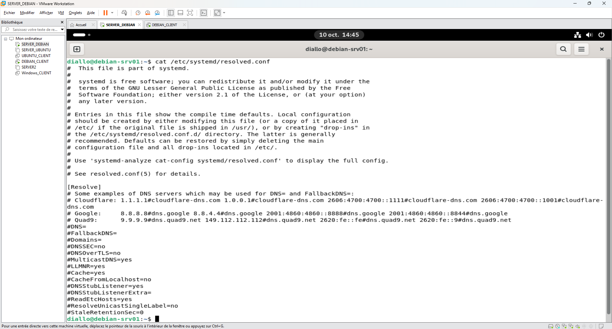
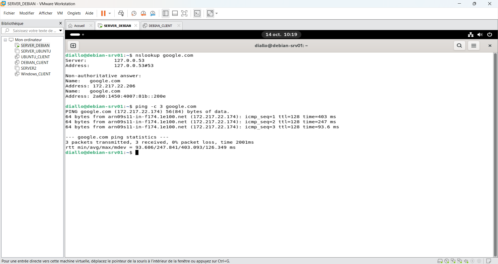
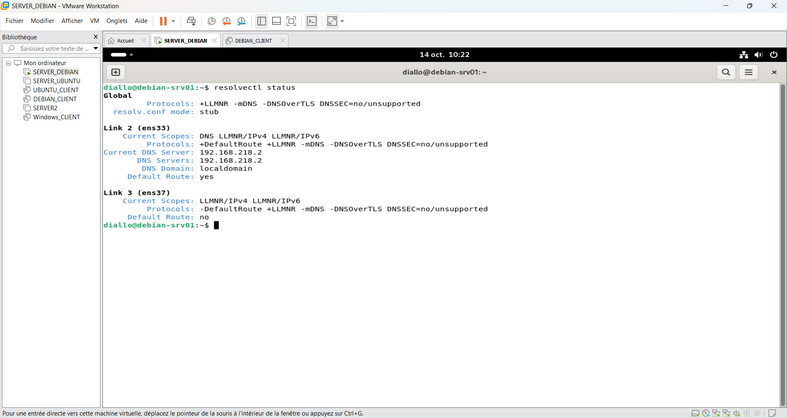

# Incident 03 – Résolution DNS en panne

## 1. Contexte

Le serveur `debian-srv01` dispose d'une connexion Internet fonctionnelle, mais ne parvient plus à résoudre les noms de domaine.

## 2. Diagnostic

Vérification de la connectivité réseau :

```bash
ping -c 4 8.8.8.8
```

**Résultat :** 4 paquets reçus, 0 % de perte. La connectivité IP fonctionne.



Vérification de la résolution DNS :

```bash
cat /etc/resolv.conf
nslookup google.com
ping -c 4 google.com
```

**Résultat :** le résolveur local `127.0.0.53` refuse la requête DNS.



## 3. Analyse

Inspection de la configuration DNS :

```bash
cat /etc/systemd/resolved.conf
```

Les paramètres DNS sont commentés. Des vérifications supplémentaires sont nécessaires pour identifier la cause exacte.



## 4. Résolution

Le fonctionnement de la résolution DNS a été rétabli dans le laboratoire.

La modification exacte ayant permis la correction n'est pas visible sur les captures.

## 5. Vérification finale

Tests de résolution DNS et de connectivité :

```bash
nslookup google.com
ping -c 3 google.com
```

**Résultat :** résolution du nom de domaine réussie et 0 % de perte de paquets.



Vérification du serveur DNS utilisé :

```bash
resolvectl status
```

**Résultat :** l'interface `ens33` utilise le serveur DNS `192.168.218.2`.



## 6. Prévention

- Vérifier la configuration DNS après toute modification réseau.
- Contrôler le fonctionnement de `systemd-resolved`.
- Distinguer une panne DNS d'un problème de connectivité Internet.
