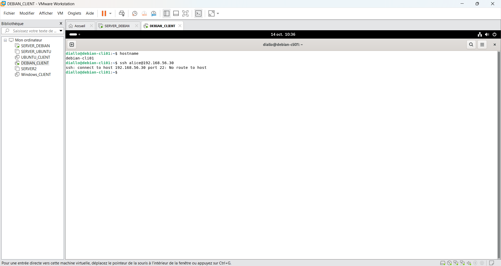
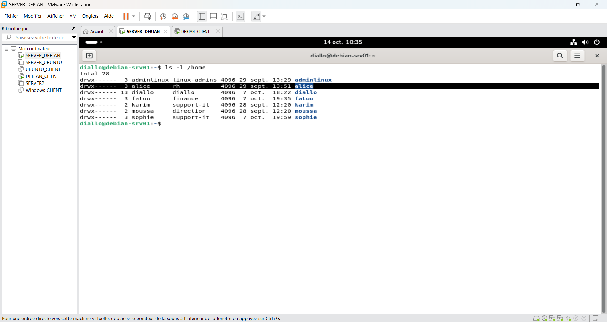
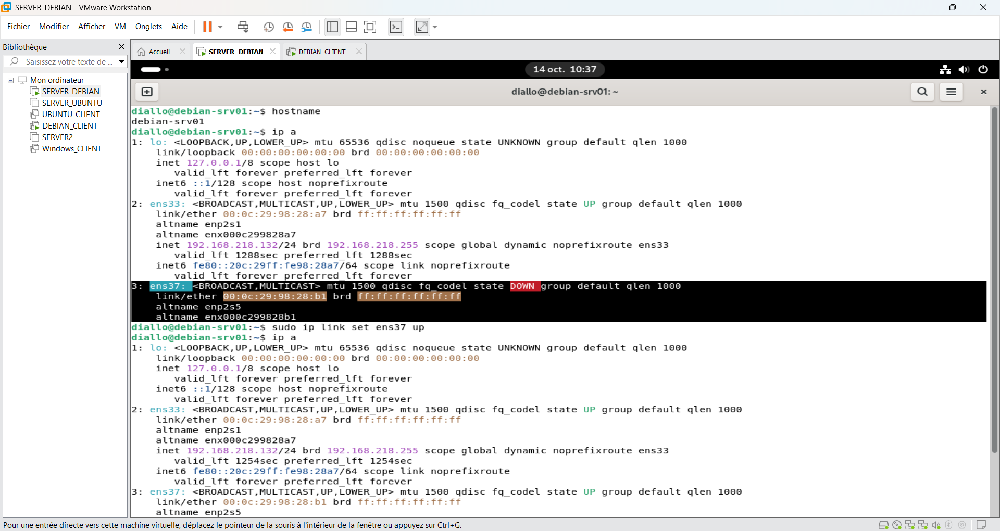
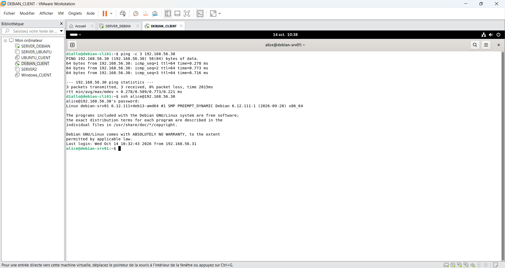
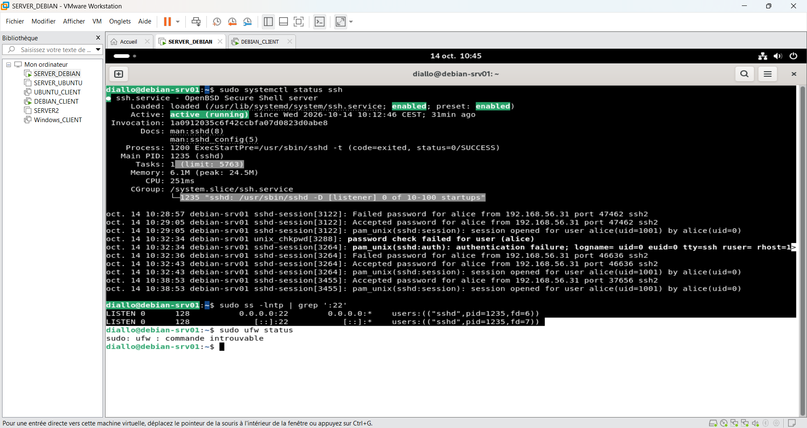
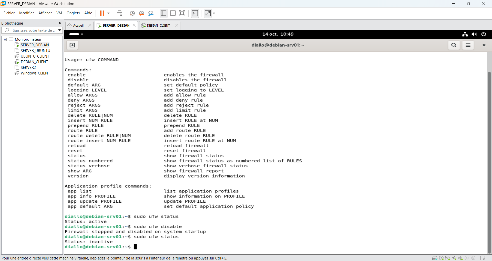

# Incident 04 – Connexion SSH inaccessible

## 1. Contexte

Depuis `debian-cli01`, l'utilisatrice Alice ne parvient plus à se connecter en SSH au serveur `debian-srv01` (`192.168.56.30`).

## 2. Problème rencontré

La tentative de connexion SSH échoue avec le message `No route to host`.

```bash
ssh alice@192.168.56.30
```



## 3. Diagnostic

Vérification des comptes utilisateurs et des interfaces réseau.

```bash
ls -l /home
hostname
ip a
```

Le compte Alice existe, mais l'interface réseau `ens37`, utilisée pour la communication entre les machines, est désactivée (`DOWN`).





**Cause identifiée :** interface réseau `ens37` désactivée, empêchant l'accès au serveur depuis le réseau local.

## 4. Résolution

Réactivation de l'interface réseau :

```bash
sudo ip link set ens37 up
ip a
```

L'interface `ens37` passe à l'état `UP`.


## 5. Vérification finale

Test de connectivité réseau :

```bash
ping 192.168.56.31
```

**Résultat :** 3 paquets reçus, 0 % de perte.

.png)

Nouvelle tentative SSH depuis `debian-cli01` :

```bash
ping -c 3 192.168.56.30
ssh alice@192.168.56.30
```

**Résultat :** connexion SSH réussie avec le compte Alice.



Vérification du service SSH et du port 22 :

```bash
sudo systemctl status ssh
sudo ss -lntp | grep ':22'
```

Le service SSH est actif et écoute sur le port 22.



## 6. Contrôle du pare-feu

Vérification de l'état du pare-feu UFW.

```bash
sudo ufw status
sudo ufw disable
sudo ufw status
```

Les captures montrent que le pare-feu UFW a été désactivé.



## 7. Prévention

- Surveiller l'état des interfaces réseau.
- Vérifier la connectivité avant de diagnostiquer le service SSH.
- Contrôler les règles du pare-feu sans désactiver inutilement la protection.
- Vérifier la configuration réseau permanente.
