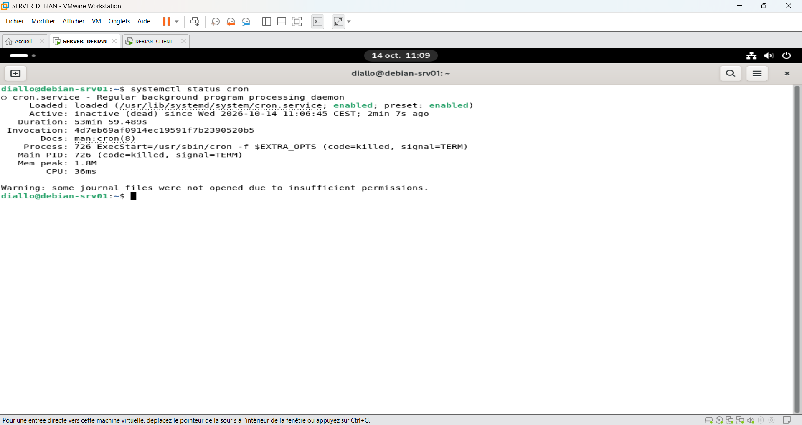
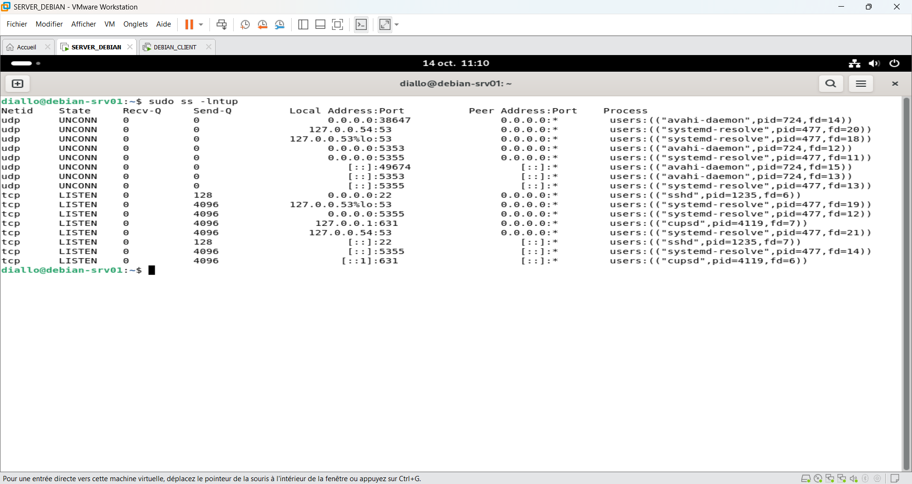
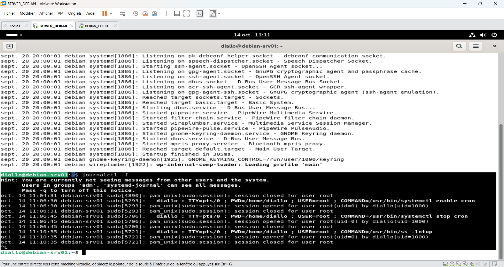
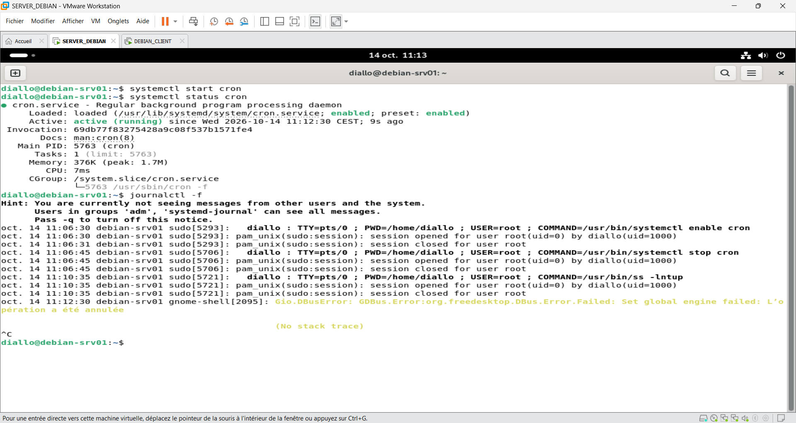

# Incident 05 – Service interne indisponible

## 1. Contexte

Sur le serveur `debian-srv01`, le service `cron`, chargé de l'exécution automatique des tâches planifiées, est indisponible.

## 2. Problème rencontré

Vérification de l'état du service :

```bash
systemctl status cron
```

**Résultat :** le service affiche `inactive (dead)`. Il est arrêté et ne peut plus exécuter les tâches planifiées.



## 3. Diagnostic

Vérification des ports et processus réseau :

```bash
sudo ss -lntup
```

Le service `cron` ne possède pas de port d'écoute réseau, car il exécute des tâches localement.



Consultation des journaux système :

```bash
journalctl -f
```

Les journaux montrent qu'une commande `systemctl stop cron` a été exécutée, confirmant l'arrêt volontaire du service dans le cadre de la simulation.



## 4. Résolution

Redémarrage du service `cron` :

```bash
systemctl start cron
systemctl status cron
```

**Résultat :** le service passe à l'état `active (running)`.



## 5. Vérification finale

La commande `systemctl status cron` confirme que le service fonctionne à nouveau.

**Incident résolu :** le service `cron` est opérationnel. L'exécution effective des tâches planifiées reste à vérifier.

## 6. Prévention

- Surveiller régulièrement l'état des services.
- Consulter les journaux avec `journalctl`.
- Vérifier les tâches planifiées après un incident.
- Contrôler que le service est activé au démarrage.
