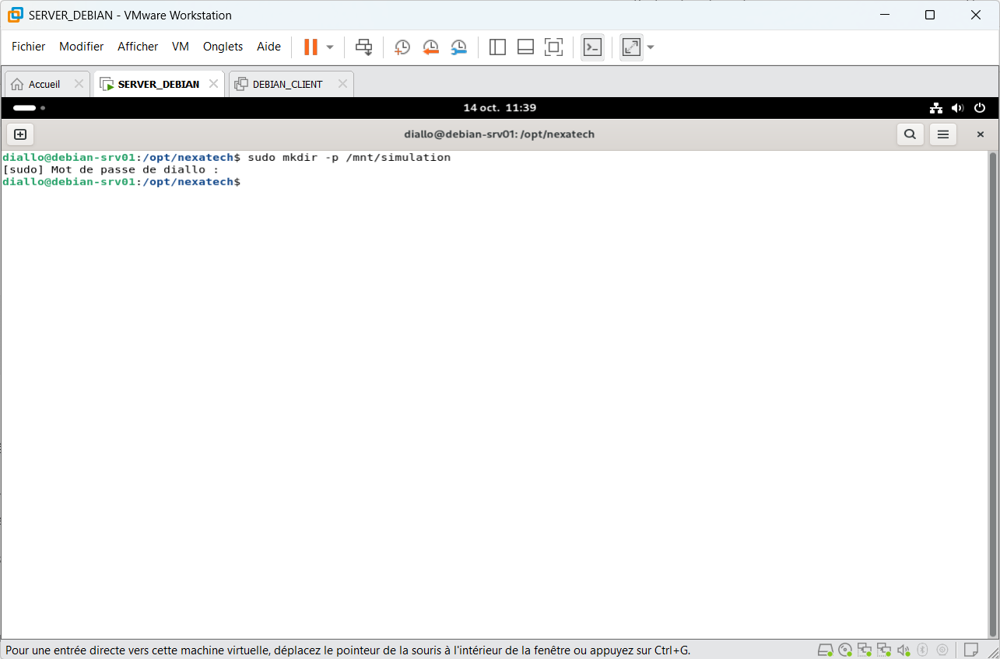
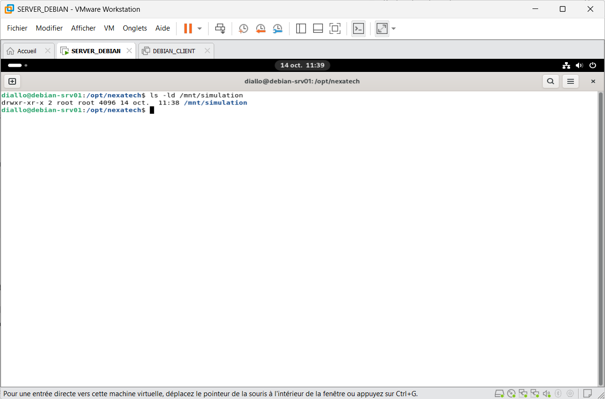
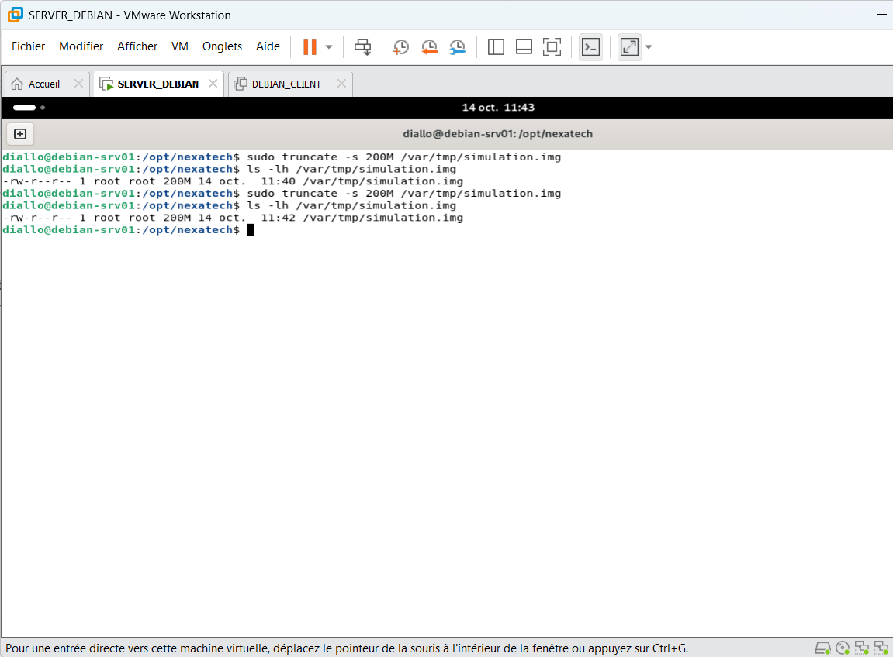
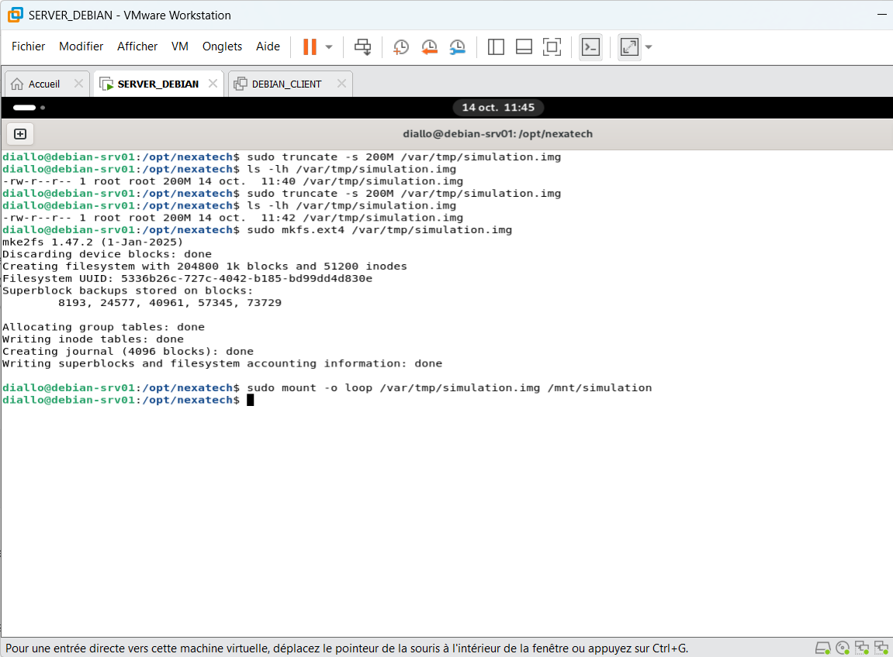
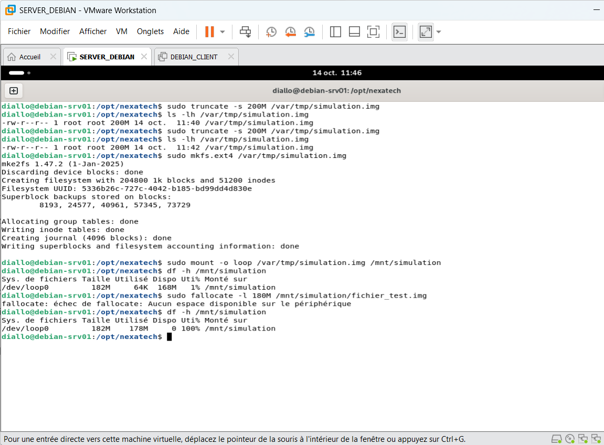
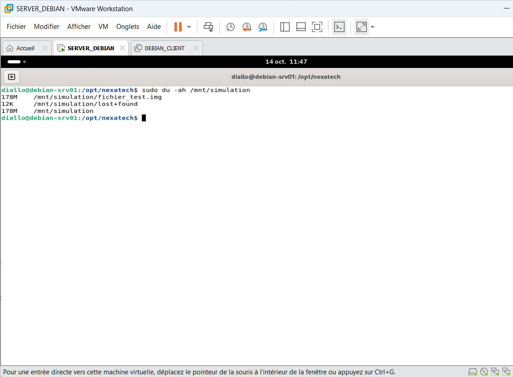
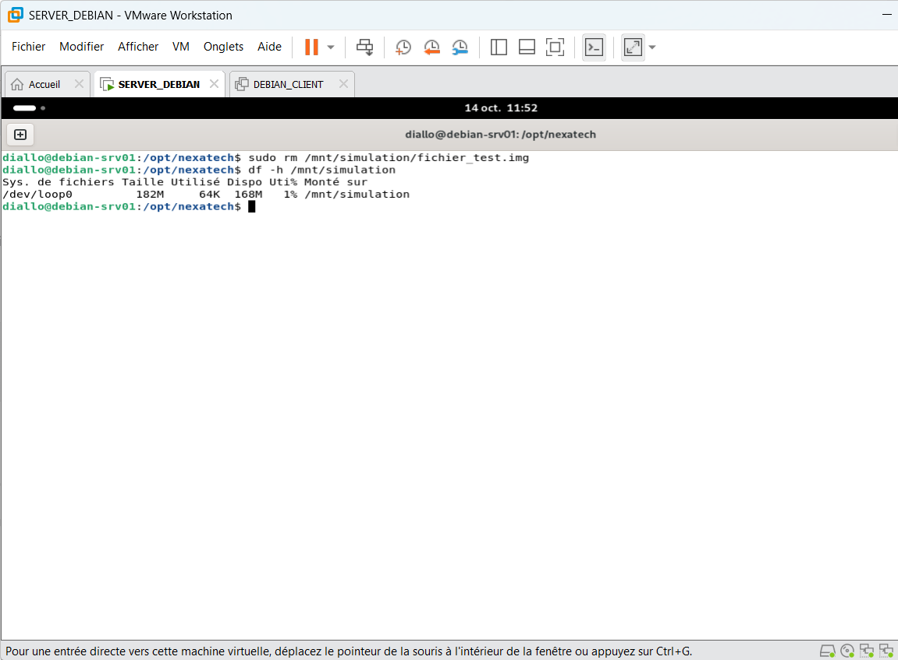
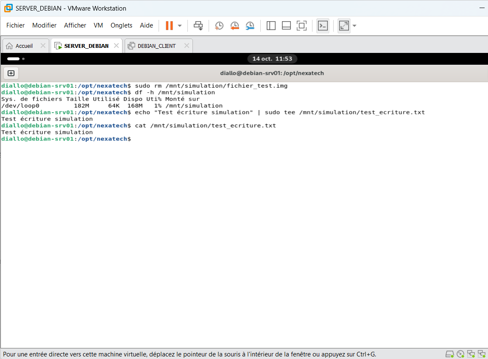

# Incident 06 – Espace disque saturé

## 1. Contexte

Simulation d'une saturation de disque sur `debian-srv01` afin de comprendre les erreurs d'écriture et les méthodes de diagnostic sous Linux.

## 2. Préparation de l'environnement

Création du point de montage :

```bash
sudo mkdir -p /mnt/simulation
ls -ld /mnt/simulation
```





Création d'une image disque de 200 Mo :

```bash
sudo truncate -s 200M /var/tmp/simulation.img
ls -lh /var/tmp/simulation.img
```



Formatage en ext4 et montage :

```bash
sudo mkfs.ext4 /var/tmp/simulation.img
sudo mount -o loop /var/tmp/simulation.img /mnt/simulation
```



## 3. Simulation de l'incident

Création d'un fichier volumineux pour saturer le système de fichiers :

```bash
sudo fallocate -l 180M /mnt/simulation/fichier_test.img
df -h /mnt/simulation
```

**Résultat :** erreur `Aucun espace disponible sur le périphérique`. Le système de fichiers atteint 100 % d'utilisation.



## 4. Diagnostic

Identification du fichier consommant l'espace :

```bash
sudo du -ah /mnt/simulation
```

**Résultat :** le fichier `fichier_test.img` occupe environ 178 Mo sur le système de fichiers simulé.



## 5. Résolution

Suppression du fichier créé pour la simulation :

```bash
sudo rm /mnt/simulation/fichier_test.img
df -h /mnt/simulation
```

**Résultat :** l'utilisation du système de fichiers redescend à 1 %.



## 6. Vérification finale

Test de création et de lecture d'un fichier :

```bash
echo "Test écriture simulation" | sudo tee /mnt/simulation/test_ecriture.txt
cat /mnt/simulation/test_ecriture.txt
```

**Résultat :** écriture et lecture réussies. Le système de fichiers fonctionne à nouveau.



## 7. Prévention

- Surveiller régulièrement l'espace disponible avec `df -h`.
- Identifier les fichiers volumineux avec `du`.
- Prévoir des alertes en cas de saturation.
- Vérifier les fichiers avant toute suppression.
