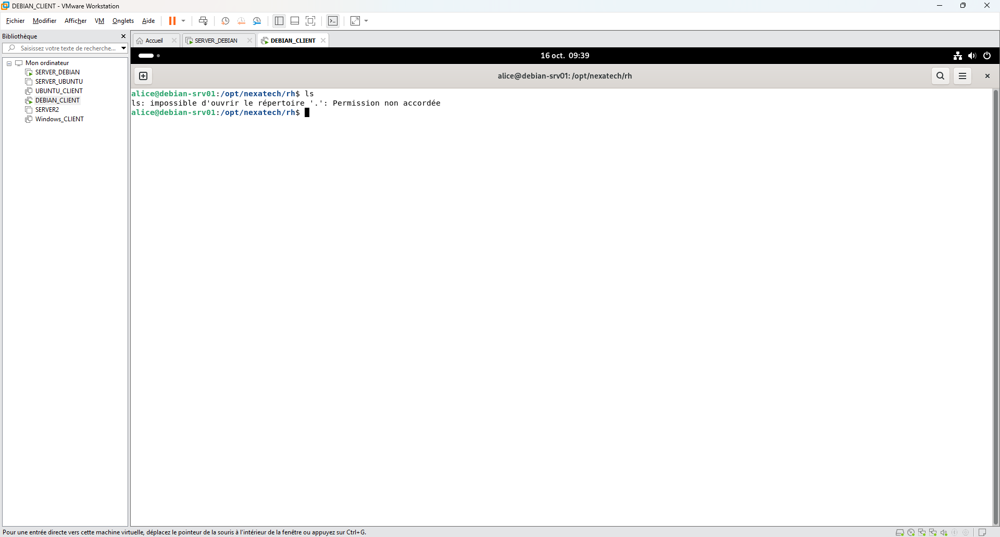
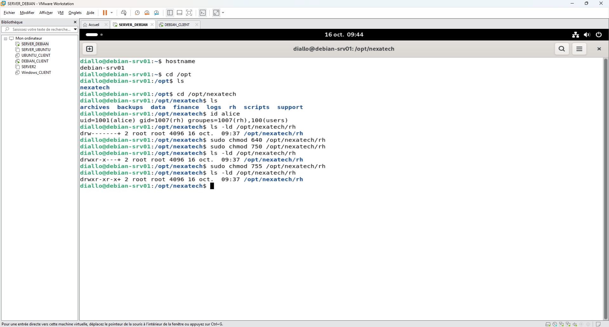
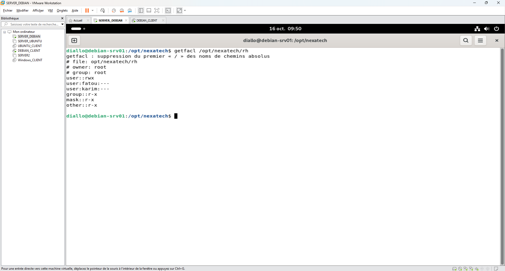
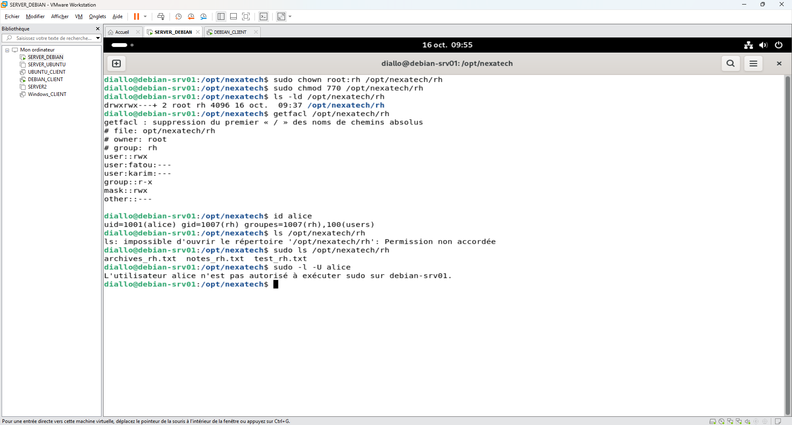
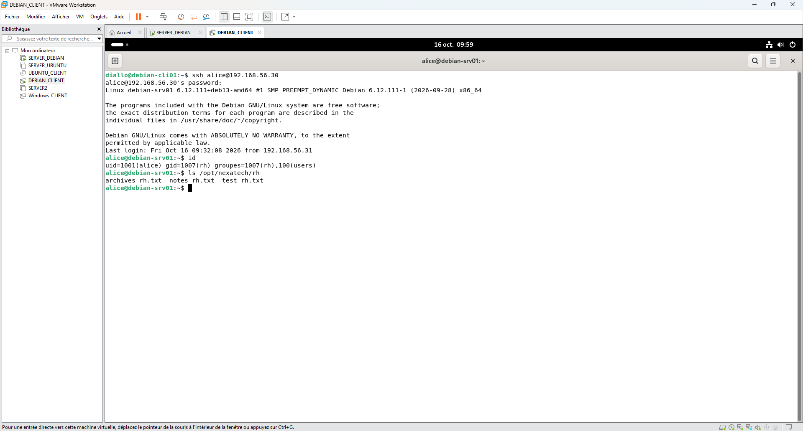
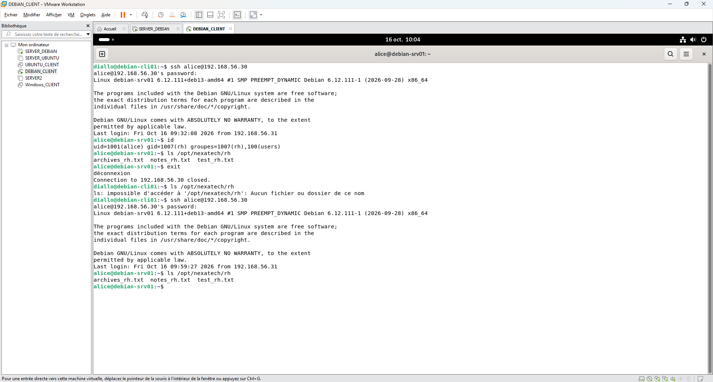

# Incident 07 – Problème de compte et privilèges

## 1. Contexte

L'utilisatrice Alice, membre du service RH, ne parvient plus à consulter le répertoire `/opt/nexatech/rh` sur le serveur Debian 13.

## 2. Problème rencontré

La commande `ls` exécutée par Alice retourne le message `Permission non accordée`.



## 3. Diagnostic

Vérification du compte, des groupes et des permissions :

```bash
id alice
ls -ld /opt/nexatech/rh
getfacl /opt/nexatech/rh
```

Alice appartient au groupe `rh`, mais le dossier est associé à `root:root`. Les permissions et les ACL sont examinées pour identifier les restrictions d'accès.





## 4. Résolution

Modification du groupe propriétaire et des permissions du dossier :

```bash
sudo chown root:rh /opt/nexatech/rh
sudo chmod 770 /opt/nexatech/rh
```

Le groupe `rh` obtient les droits de lecture, écriture et traversée du répertoire.



## 5. Vérification finale

Contrôle des permissions et des privilèges sudo, puis test d'accès avec Alice.

```bash
getfacl /opt/nexatech/rh
id alice
sudo -l -U alice
```

Alice appartient au groupe `rh` et ne possède pas de privilèges sudo.



Depuis `debian-cli01`, Alice se connecte au serveur en SSH et parvient à afficher les fichiers du répertoire RH.

```bash
ssh alice@192.168.56.30
ls /opt/nexatech/rh
```

**Résultat :** accès au répertoire RH rétabli.



## 6. Prévention

- Gérer les permissions par groupes.
- Vérifier les ACL avant de modifier les droits.
- Appliquer le principe du moindre privilège.
- Contrôler les permissions après chaque modification.
